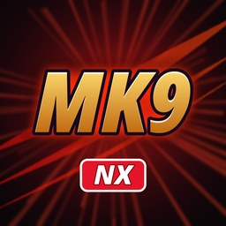

# mk9-nx

A static recompilation of **Mortal Kombat Komplete Edition** (Xbox 360, title 575207FD) for PC and Nintendo Switch,
made with the ReXGlue SDK. It is built on [usf4-nx](https://github.com/Thorhax/usf4-nx) (Ultra Street Fighter IV),
which follows the method of [sa2-nx](https://github.com/ChanseyIsTheBest/sa2-nx)
(`docs/porting-a-360-game-prompt.md`).

**This repository holds no game data.** You need your own copy of the game: the Xbox 360 disc, dumped to a plain
`.iso`. The game files and the shaders made from them are never committed or published; the installer makes them from
your own disc.

## Status

- **Switch (Atmosphère, homebrew NRO):** the game draws with Renut's renderer on deko3d, the Switch's own graphics
  API (reNut by masterspike52, used with the author's permission, as banjo-nx, sa2-nx and usf4-nx carry it), at
  1280x720. Fights hold 60 fps on most stages (the heaviest, Hell, about 59), measured on a console with the CPU at
  1785 MHz, the GPU at 768 MHz and the memory at 1800 MHz. Arcade and Tag Ladder, Practice, Challenge Tower, the
  Krypt and Story mode's opening cutscene were played on the console. The menus, the move list and the
  controller settings show Switch buttons (`mk9_button_icons` in `mk9.toml`: `"switch"` or `"xbox"`).
- **PC:** the development build; not released.

Every finding and measurement: [docs/mk9-notes.md](docs/mk9-notes.md).

## How to install (Switch)

1. Open the installer page: **https://thorhax.github.io/mk9-nx-installer/**
2. Choose your game's disc image (a plain `.iso` of the Xbox 360 disc, not a compressed CCI/GOD/ZAR image) or a folder
   you extracted the disc into, then press **Create mk9-nx.zip**. Everything runs in your browser and your game files
   never leave your computer: the page checks your copy, downloads the Switch build from this repository's releases,
   and makes the shaders and the game folder from your files. Making the shaders takes a few minutes on a fast PC
   (19,010 of them, on all its cores); keep the tab open.
3. Extract the downloaded `mk9-nx.zip` (about 7 GB) into `sdmc:/switch/`.

Your `mk9-nx` folder then holds `mk9.nro`, `LICENSES.txt`, the renderer's shaders (`deko3d_glsl.bin`, made from your
disc) and the game files in `game_root/`. Start `mk9.nro` with a title takeover (hold **R** while launching an installed
game) or a forwarder with full memory; the album applet does not give the game enough memory. The game writes
`mk9.toml` (your settings) at its first start.

**The first time you play,** scenery can be missing for a moment at a stage's first intro while its shaders are
compiled; they are kept on the SD card (`deko3d_shaders.bin`) for the next sessions.

**Updating:** open the installer page again and press **Create mk9-nx-update.zip**: it only holds the new NRO and the
shaders. Extract it over your folder; your settings, saves and game files stay.

## Building

See [docs/building.md](docs/building.md): the PC build, and the Switch build in the `devkitpro/devkita64` Docker image
(a release build: `-DSA2_RENUT_RELEASE_SHADERS=ON`, no game shader in the NRO). The disc goes in `assets/game_root`
(the executable is `default.xex`, lower case); the decrypted image for the analysis tools comes from
`python3 tools/xex_image.py assets/game_root/default.xex out/default_image.bin`.

## Icon

`app/icon.jpg` is the project's own icon. To use your own on your Switch build, put a 256x256 JPEG at
`app/icon_local.jpg` (git-ignored) and rebuild.

## License

GPL-3.0, see [LICENSE](LICENSE). Third-party components: [THIRD_PARTY_NOTICES.md](THIRD_PARTY_NOTICES.md). Mortal
Kombat is a trademark of Warner Bros. Entertainment; this project is not affiliated with or endorsed by Warner Bros.
or NetherRealm Studios.
